# Software Requirement Specification Document

**Project Name:** Savers  
**Author:** Ridho Faiq Ahmad  

| Field | Value |
| --- | --- |
| **Document ID** | SOFTWARE REQUIREMENT SPECIFICATION-v0.2 |
| **Version Number** | 0.2 |
| **Issue Date** | 25 November 2026 |
| **Classification** | Public |

---

## Copyright Notice

© 2026 Ridho Faiq Ahmad. Hak cipta dilindungi.  
All Rights Reserved

Dokumen ini disusun untuk keperluan akademik pada mata kuliah Pengembangan Aplikasi Mobile. Dokumen boleh digunakan untuk peninjauan dan penilaian proyek Savers. Penggunaan atau penyebaran di luar keperluan tersebut harus mencantumkan nama penulis dan sumber dokumen.

Informasi dalam dokumen ini menjelaskan kebutuhan proyek pada versi dan tanggal yang tercantum. Isi dapat berubah melalui revisi SRS selama pengerjaan proyek. Dokumen ini bukan kontrak dan tidak menjamin bahwa fitur yang dijelaskan telah diimplementasikan.

---

## Revision History

| Date | Version | Description | Author(s) |
| --- | --- | --- | --- |
| 11/21/2026 | 0.1 | Draft Version | Ridho Faiq Ahmad |
| 11/25/2026 | 0.2 | Penyesuaian role STANDARD & PRO, penambahan fitur CRUDS maksimal, field dinamis, serta pelengkapan Bab 3–6 dan Appendix A | Ridho Faiq Ahmad |

| Reviewed By (Customer) | Signature | Date |
| --- | --- | --- |
| | | |

The reviewer signoff shall signify the recommendation for acceptance of this document.

---

## Sign Off

| Prepared By | Acknowledged By |
| --- | --- |
| Ridho Faiq Ahmad | TBD |
| Title: Mahasiswa | Title: Pembimbing / Reviewer |
| Universitas Muhammadiyah Yogyakarta | Universitas Muhammadiyah Yogyakarta |
| Date: TBD | Date: TBD |

| Accepted By | Accepted By |
| --- | --- |
| TBD | `<Name>` |
| Title: Dosen Pengampu | Title: `<Position>` |
| Universitas Muhammadiyah Yogyakarta | `<Customer Company Name>` |
| Date: TBD | Date: TBD |

---

## 1 Introduction

### 1.1 Purpose
SRS ini menetapkan kebutuhan fungsional dan nonfungsional **Savers** agar mahasiswa, reviewer, pengembang, penguji, dan dosen memiliki acuan tunggal saat merancang, membangun, memeriksa, dan mendemonstrasikan aplikasi. Setiap kebutuhan diberi ID stabil supaya dapat dilacak ke fitur, model data, dan ketentuan proyek akhir.

### 1.2 Document Conventions
Istilah “harus/wajib” menyatakan kebutuhan normatif. Kebutuhan ditulis dengan pola ID, aktor/kondisi, respons sistem, dan kriteria verifikasi. ID unik memakai awalan `FR` untuk kebutuhan fungsional, `NFR` untuk nonfungsional, `IR` untuk antarmuka, dan `DBR` untuk data. “TBD” menandai keputusan yang belum tersedia dan harus ditutup sebelum implementasi terkait diselesaikan. Prioritas: **Must** (wajib untuk kesesuaian pedoman), **Should** (penting), **Could** (opsional bila waktu memungkinkan). Kebutuhan tanpa label prioritas mewarisi **Must** untuk persyaratan minimum PAM.

### 1.3 Intended Audience and Reading Suggestions
Mahasiswa membaca Bagian 1–2 untuk memahami tujuan dan batasan; Bagian 3 untuk membangun perilaku per fitur; Bagian 4–6 untuk integrasi, kualitas, dan struktur data. Reviewer/dosen dapat memeriksa Bagian 3 dan Matriks Keterlacakan pada Bagian 6.3. SRS ini mengikuti kerangka template yang diberikan, dengan diagram yang diminta pemilik proyek ditambahkan pada bab terkait.

### 1.4 Project Scope
**Savers** adalah aplikasi Android berbahasa Indonesia yang membantu pengguna mengatur target tabungan, mencatat setoran dan transaksi umum, mengelola kategori, mengelola rencana setoran berkala, mengatur anggaran bulanan (*budgeting*), melihat ringkasan finansial, serta menyimpan, mengekspor, dan membaca kembali laporan dalam format PDF/CSV di penyimpanan lokal. Backend mandiri menyediakan REST API JSON dan PostgreSQL cloud menyimpan data persisten dengan dukungan field dinamis (`JSONB`). Aplikasi menyediakan akses cache terakhir secara baca-saja ketika offline; perubahan data memerlukan koneksi.

* **Dalam lingkup:** Autentikasi (Register, Login, JWT Access & Refresh Token, Logout), otorisasi berbasis peran (`STANDARD` dan `PRO`), manajemen kategori (CRUDS), manajemen target tabungan (CRUDS), manajemen transaksi & setoran (CRUDS), manajemen rencana setoran berkala (CRUDS - `PRO`), manajemen anggaran bulanan (CRUDS - `PRO`), dashboard ringkasan finansial, simpan & baca file laporan lokal PDF/CSV, cache offline terenkripsi, validasi, dan penanganan error.
* **Di luar lingkup versi ini:** Koneksi rekening bank / *open banking*, payment gateway pembayaran otomatis, sinkronisasi mutasi bank, fitur investasi, nasihat finansial profesional, serta pemotongan saldo otomatis oleh sistem.

### 1.5 References
1. *PEDOMAN PROJECT AKHIR PENGEMBANGAN APLIKASI MOBILE 2026*, materi resmi mata kuliah.
2. *Software Requirement Specification Document Template*, versi PDF resmi mata kuliah.
3. *ISO/IEC/IEEE 29148:2018*, Systems and software engineering — Life cycle processes — Requirements engineering.
4. Dokumentasi resmi Android Developers: Jetpack Compose, Navigation Compose, Architecture recommendations, Jetpack DataStore, dan Android Storage Access Framework.
5. Dokumentasi resmi Node.js, Express, PostgreSQL (`JSONB`), JWT/JWS, dan TLS.

### 1.6 Acronyms and Abbreviations
| Istilah | Kepanjangan / Arti |
| --- | --- |
| SRS | Software Requirement Specification |
| API | Application Programming Interface |
| CRUDS | Create, Read, Update, Delete, Search |
| JWT | JSON Web Token |
| RBAC | Role-Based Access Control |
| REST | Representational State Transfer |
| MVVM | Model-View-ViewModel |
| TBD | To Be Determined / Belum Diputuskan |
| UI / UX | User Interface / User Experience |
| RAT | Relasi Antar Tabel |

---

## 2 Overall Description

### 2.1 Product Perspective
Savers adalah aplikasi klien-server baru. Aplikasi Android berkomunikasi lewat HTTPS dengan REST API Node.js/Express; API memvalidasi autentikasi, otorisasi peran (`STANDARD`/`PRO`) serta kepemilikan data, menerapkan aturan bisnis, dan menyimpan data ke PostgreSQL cloud. Cache lokal bukan basis data relasional (tanpa Room/SQLite) dan tidak menjadi sumber kebenaran; cache digunakan untuk tampilan baca saat offline. Komponen ekspor membuat berkas PDF/CSV di penyimpanan lokal perangkat dan menyediakan pembacaan ulang berkas tersimpan.

### 2.2 Product Features
1. Registrasi, login, perpanjangan sesi otomatis menggunakan JWT *access token* dan *refresh token*, serta logout.
2. Otorisasi berbasis peran (`STANDARD` dan `PRO`) dengan *Role-based UI* serta validasi hak akses di backend.
3. Dashboard ringkasan finansial yang memisahkan progres target/setoran dari pemasukan, pengeluaran umum, dan status anggaran bulanan.
4. Manajemen profil pengguna (lihat & ubah profil, serta informasi paket/role akun).
5. Manajemen kategori pribadi & bawaan dengan operasi CRUDS penuh dan field dinamis.
6. Manajemen target tabungan dengan operasi CRUDS penuh, tenggat, status, dan field dinamis.
7. Pencatatan & pengelolaan transaksi (setoran target, pemasukan umum, pengeluaran umum) dengan operasi CRUDS penuh dan field dinamis.
8. Manajemen rencana setoran berkala dengan operasi CRUDS penuh dan field dinamis (fitur khusus `PRO`).
9. Manajemen anggaran bulanan (*monthly budgets*) per kategori dengan operasi CRUDS penuh dan field dinamis (fitur khusus `PRO`).
10. Ekspor laporan ke PDF/CSV ke penyimpanan lokal perangkat serta fitur baca/preview daftar file laporan lokal yang tersimpan.

### 2.3 User Classes and Characteristics
| Aktor / Kelas | Karakteristik dan Hak Akses |
| --- | --- |
| **Pengunjung** | Belum terautentikasi; hanya dapat mengakses layar Registrasi dan Login. |
| **Pengguna `STANDARD`** | Pengguna terdaftar tingkat dasar; mengakses dan mengubah data miliknya untuk Profil, Dashboard dasar, Kategori (maks. batas tertentu / baca kategori bawaan), Target Tabungan (maks. 3 target aktif), Transaksi, serta Ekspor & Baca file CSV. Fitur `PRO` tampil terkunci di UI. |
| **Pengguna `PRO`** | Pengguna terdaftar tingkat lanjut; memiliki seluruh hak akses `STANDARD` tanpa batas target aktif, ditambah akses penuh ke Rencana Setoran Berkala, Anggaran Bulanan, analitik ringkasan lanjutan, dan Ekspor & Baca file PDF maupun CSV. |
| **Backend Savers** | Aktor sistem; memverifikasi JWT, role (`STANDARD`/`PRO`), kepemilikan `user_id` pada tiap endpoint, menerapkan aturan bisnis, dan mengembalikan respons JSON/kode status HTTP yang sesuai. |
| **Reviewer / Dosen** | Memeriksa kesesuaian SRS, demonstrasi aplikasi, dan wawancara teknis; bukan role di dalam aplikasi. |

### 2.4 Operating Environment
| Komponen | Spesifikasi |
| --- | --- |
| **Perangkat Klien** | Ponsel Android (minimum Android 8.0 / API Level 26). |
| **Aplikasi Android** | Kotlin, Jetpack Compose Material 3; tanpa layout XML atau View tradisional. |
| **Navigasi** | Jetpack Navigation Compose / Navigator Compose. |
| **Arsitektur** | MVVM; UI state melalui `StateFlow` / `MutableStateFlow` pada `ViewModel`. |
| **Backend** | REST API JSON dengan Node.js / Express. |
| **Database** | PostgreSQL Cloud (mendukung relasi FK dan kolom dinamis `JSONB`). |
| **Jaringan** | HTTPS/TLS; operasi tulis dan sinkronisasi memerlukan koneksi internet. |
| **Penyimpanan Berkas** | Penyimpanan lokal Android (internal app storage `filesDir/reports` & `Downloads` via MediaStore/FileProvider) + Jetpack DataStore untuk token/cache terenkripsi; tanpa Room/SQLite. |

### 2.5 Design and Implementation Constraints
1. Semua halaman dibangun 100% dengan **Jetpack Compose dan Material 3**; XML layout / View tradisional dilarang keras oleh pedoman.
2. Navigasi multi-halaman hanya menggunakan **Navigator Compose** (`NavHost`).
3. State dan aturan presentasi dipisahkan melalui **MVVM**; Composable hanya mengamati `StateFlow` dari `ViewModel`.
4. Backend wajib REST API bertukar **JSON**; database menggunakan **PostgreSQL cloud** (memenuhi syarat minimal MySQL).
5. **Room dan SQLite dilarang**; penyimpanan lokal hanya untuk file laporan (PDF/CSV), file cache JSON privat, dan Jetpack DataStore.
6. *Access token* berumur pendek (misal 15 menit) dan *refresh token* berumur panjang (misal 7 hari) dikelola aman via interceptor/authenticator.
7. Antarmuka berbahasa Indonesia dengan format mata uang Rupiah (IDR).
8. Implementasi kode wajib 100% selaras dengan SRS; setiap perubahan fitur harus memperbarui SRS terlebih dahulu.

### 2.6 User Documentation
Dokumentasi pengguna yang disertakan bersama proyek:
1. `README.md` pada repository GitHub `0216_Savers` yang berisi deskripsi proyek, arsitektur, cara menjalankan backend & aplikasi Android, serta log progres mingguan.
2. Panduan singkat penggunaan akun demo (`STANDARD` dan `PRO`) untuk keperluan pengujian dan demonstrasi.

### 2.7 Assumptions and Dependencies
1. Proyek dikerjakan secara individu, bersifat unik, dan tema `Savers` didaftarkan melalui G'Form MyKlass pada pertemuan ke-8.
2. Bahasa utama aplikasi adalah Bahasa Indonesia dan mata uang utama adalah Rupiah (IDR).
3. Pengguna memiliki perangkat Android (atau emulator) dengan akses internet untuk komunikasi ke backend Savers.
4. Untuk keperluan pengujian & demonstrasi *Authorization* (`STANDARD` vs `PRO`), disediakan akun *seed* untuk masing-masing role serta fitur **Simulasi Perubahan Paket (`STANDARD` ↔ `PRO`)** pada halaman Profil yang memperbarui role di database dan menerbitkan JWT baru (tanpa integrasi payment gateway).
5. Rencana setoran hanya menjadwalkan pengingat/rencana; pencatatan saldo tetap melalui konfirmasi transaksi pengguna.
6. Nama repository `0216_Savers` mengikuti format `4NIMBelakang_NamaProject`.

### Use Case Diagram
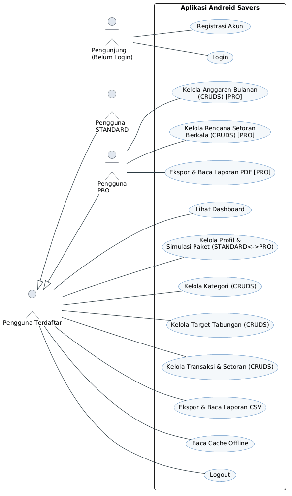

Diagram ini menunjukkan aktor **Pengunjung** dan **Pengguna Terdaftar** yang terbagi menjadi **Pengguna `STANDARD`** dan **Pengguna `PRO`**. Pengunjung hanya dapat melakukan registrasi dan login. Pengguna `STANDARD` dapat melihat dashboard, mengelola profil dan simulasi perubahan paket (`STANDARD` ↔ `PRO`), kategori (CRUDS), target tabungan maksimal 3 aktif (CRUDS), transaksi (CRUDS), ekspor dan baca laporan CSV, serta membaca cache offline. Pengguna `PRO` memperoleh seluruh hak akses tersebut tanpa batas target, ditambah **Rencana Setoran Berkala (CRUDS)**, **Anggaran Bulanan (CRUDS)**, dan **ekspor/baca laporan PDF**.

---

## 3 System Features

### 3.1 Autentikasi, Sesi JWT & Otorisasi Peran
#### 3.1.1 Description and Priority
Mengelola pendaftaran akun baru, login, pembaruan *access token* otomatis menggunakan *refresh token*, logout, serta pembedaan hak akses berbasis peran (`STANDARD` dan `PRO`).  
**Prioritas:** Must (High — Benefit: 9, Penalty: 9, Cost: 5, Risk: 4).

#### 3.1.2 Stimulus/Response Sequences
1. Pengunjung mengisi form registrasi (nama, email, kata sandi) dan menekan tombol Daftar → Sistem memvalidasi input, membuat akun dengan role default `STANDARD`, mengembalikan JWT *access token* & *refresh token*, lalu mengarahkan ke Dashboard.
2. Pengunjung mengisi email dan kata sandi pada layar Login → Sistem memverifikasi kredensial, mengembalikan JWT (`userId`, `role`), menyimpannya di DataStore, dan menampilkan UI sesuai role.
3. Ketika request API menerima HTTP `401 Unauthorized` karena *access token* kedaluwarsa → *Authenticator* otomatis memanggil endpoint refresh dengan *refresh token*; jika valid, token baru disimpan dan request diulang; jika tidak valid/dicabut, sesi dihapus dan pengguna diarahkan ke Login.
4. Pengguna `STANDARD` menekan fitur khusus `PRO` → UI menampilkan dialog/keterangan akses terbatas (`PRO Required`) dan jika dipanggil langsung ke API, backend mengembalikan `403 Forbidden`.

#### 3.1.3 Functional Requirements
* **FR-AUTH-1:** Sistem harus menyediakan registrasi akun dengan validasi format email, panjang kata sandi minimal 8 karakter, dan keunikan email (`409 Conflict` jika duplikat).
* **FR-AUTH-2:** Sistem harus menyediakan login dengan verifikasi hash kata sandi (bcrypt/argon2) dan mengembalikan `access_token` (JWT) serta `refresh_token`.
* **FR-AUTH-3:** Sistem harus menyediakan endpoint dan mekanisme *auto-refresh* token menggunakan `refresh_token` yang tersimpan ter-hash di database.
* **FR-AUTH-4:** Sistem harus menyediakan logout yang mencabut `refresh_token` di server dan menghapus sesi lokal di Android.
* **FR-AUTH-5:** Sistem harus menerapkan RBAC untuk role `STANDARD` dan `PRO` baik pada tampilan Jetpack Compose (*Role-based UI*) maupun middleware otorisasi backend (`403 Forbidden`).
* **FR-AUTH-6 (Simulasi Perubahan Paket):** Sistem harus menyediakan endpoint dan tombol pada halaman Profil untuk mengubah peran akun aktif (`STANDARD` ↔ `PRO`) secara langsung di database PostgreSQL serta menerbitkan *access token* dan *refresh token* baru sehingga perubahan hak akses langsung berlaku di UI tanpa perlu login ulang.

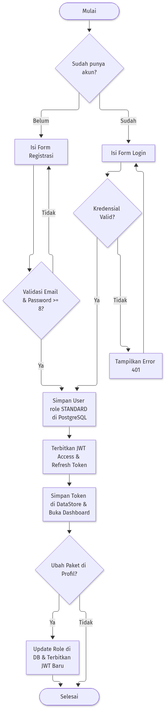

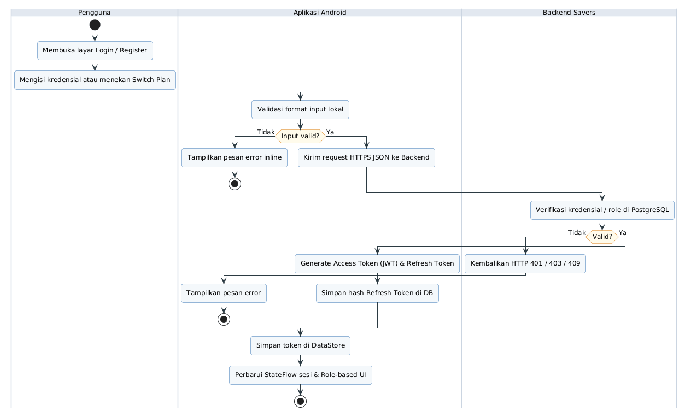

---

### 3.2 Dashboard Ringkasan Finansial & Profil Pengguna
#### 3.2.1 Description and Priority
Menampilkan ringkasan total saldo tabungan, progres target aktif, ringkasan pemasukan & pengeluaran bulan berjalan, status anggaran (khusus `PRO`), serta pengelolaan data profil dan preferensi dinamis pengguna.  
**Prioritas:** Must (High — Benefit: 8, Penalty: 7, Cost: 4, Risk: 3).

#### 3.2.2 Stimulus/Response Sequences
1. Pengguna membuka tab Dashboard → Sistem mengambil ringkasan dari API; jika offline, menampilkan cache JSON terakhir dengan indikator mode baca-saja.
2. Pengguna membuka layar Profil → Sistem menampilkan nama, email, role (`STANDARD`/`PRO`), dan preferensi dinamis (misal target tabungan bulanan, preferensi notifikasi); pengguna dapat mengubah dan menyimpannya.

#### 3.2.3 Functional Requirements
* **FR-DASH-1:** Dashboard harus memisahkan total akumulasi setoran target dari total pemasukan umum dan pengeluaran umum.
* **FR-DASH-2:** Dashboard harus menampilkan informasi tambahan (ringkasan anggaran bulanan & grafik tren lanjutan) khusus bagi role `PRO`, sementara role `STANDARD` melihat kartu informasi upgrade/fitur terkunci.
* **FR-PROF-1:** Pengguna harus dapat melihat dan memperbarui nama profil serta field dinamis `preferences` miliknya.

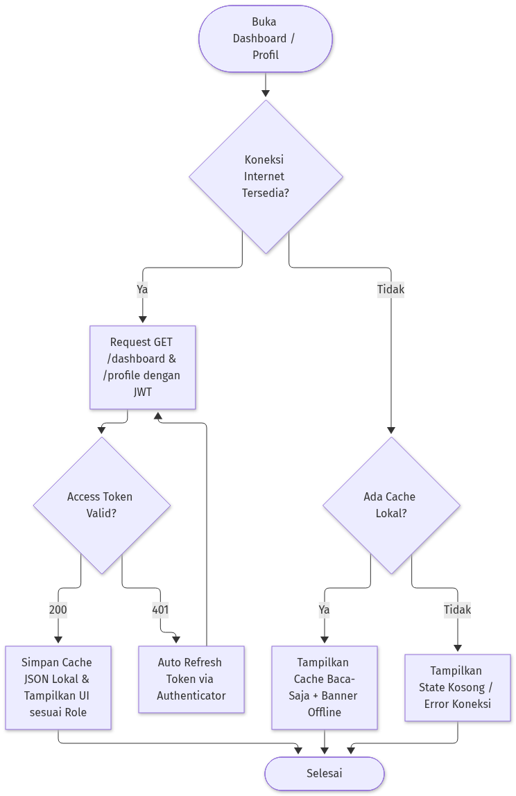

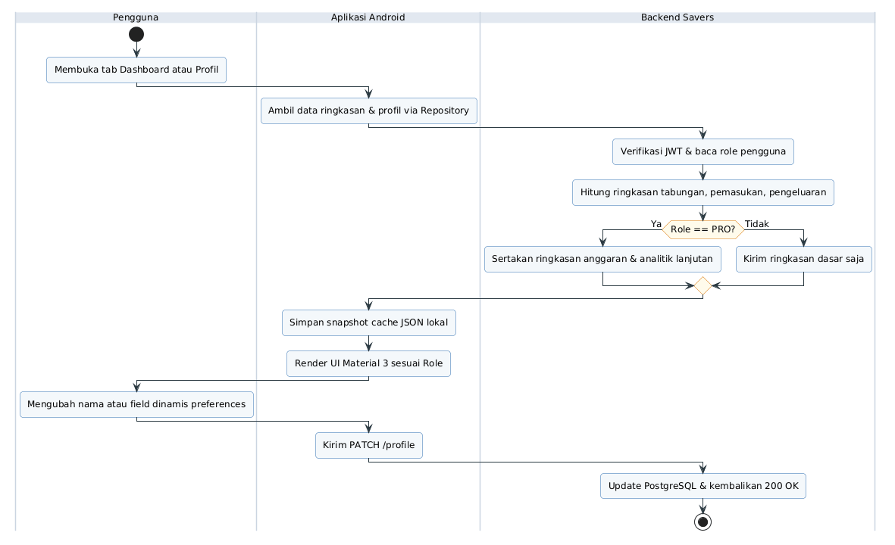

---

### 3.3 Manajemen Kategori (CRUDS)
#### 3.3.1 Description and Priority
Mengelola kategori untuk mengelompokkan Target Tabungan, Pemasukan, dan Pengeluaran. Mendukung kategori bawaan sistem (baca-saja) dan kategori pribadi milik pengguna dengan operasi CRUDS penuh dan field dinamis.  
**Prioritas:** Must (High — Benefit: 8, Penalty: 8, Cost: 4, Risk: 3).

#### 3.3.2 Stimulus/Response Sequences
1. Pengguna membuka halaman Kategori dan mengetik kata kunci di kolom pencarian atau memilih filter tipe (`INCOME`/`EXPENSE`/`SAVING`) → Sistem menampilkan daftar kategori yang cocok.
2. Pengguna menekan Tambah Kategori, mengisi nama, tipe, ikon, warna, serta field dinamis (`metadata`, misal batas wajar / kata kunci) → Sistem memvalidasi dan menyimpan ke PostgreSQL.
3. Pengguna mengedit atau menghapus kategori pribadinya → Sistem memperbarui/menghapus data jika kategori tidak sedang dikunci sistem; kategori bawaan (`user_id = NULL`) tidak dapat diubah/dihapus pengguna.

#### 3.3.3 Functional Requirements
* **FR-CAT-1 (Create):** Pengguna harus dapat membuat kategori pribadi baru dengan nama, tipe (`INCOME`, `EXPENSE`, `SAVING`), ikon, warna, dan field dinamis `metadata`.
* **FR-CAT-2 (Read):** Sistem harus menampilkan daftar kategori bawaan sistem dan kategori pribadi milik pengguna.
* **FR-CAT-3 (Update):** Pengguna harus dapat memperbarui kategori miliknya sendiri (kategori bawaan sistem bersifat *read-only*).
* **FR-CAT-4 (Delete):** Pengguna harus dapat menghapus kategori miliknya sendiri; sistem menolak penghapusan jika masih dipakai oleh transaksi/target aktif atau mengembalikan pesan error yang jelas.
* **FR-CAT-5 (Search):** Pengguna harus dapat mencari kategori berdasarkan nama dan memfilter berdasarkan tipe kategori.

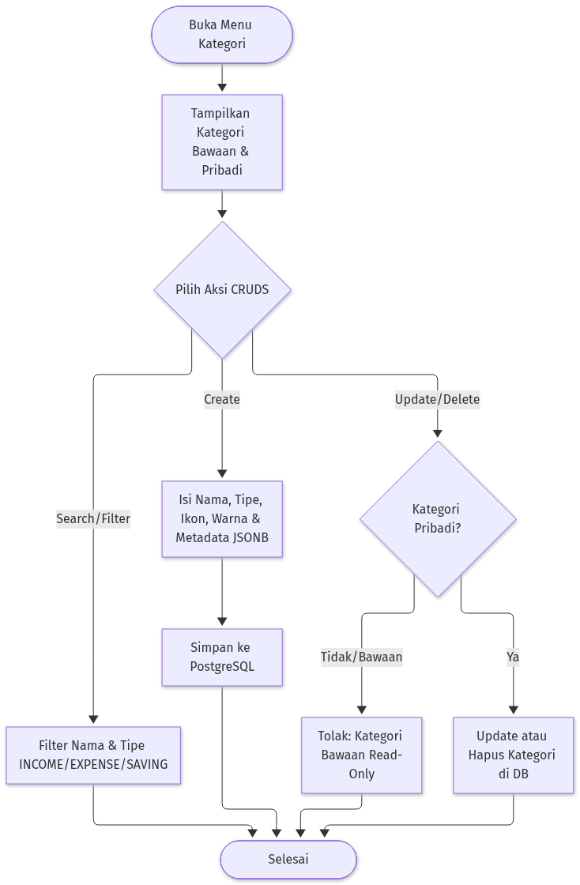

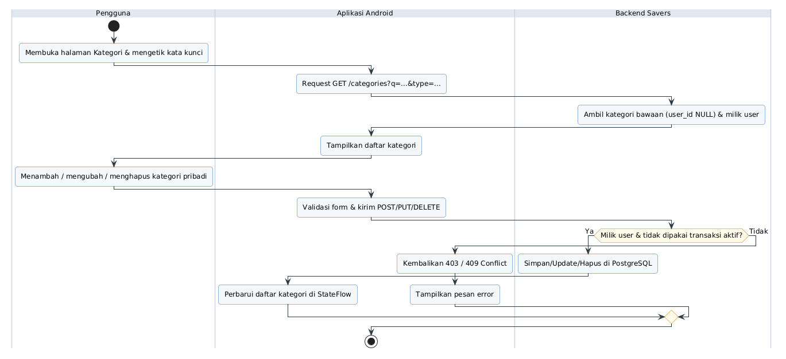

---

### 3.4 Manajemen Target Tabungan (CRUDS)
#### 3.4.1 Description and Priority
Fitur inti untuk merencanakan tujuan tabungan beserta nominal target, tenggat waktu, kategori, status, dan field dinamis kustom.  
**Prioritas:** Must (High — Benefit: 9, Penalty: 9, Cost: 5, Risk: 4).

#### 3.4.2 Stimulus/Response Sequences
1. Pengguna mengisi form Target Tabungan (judul, kategori, nominal target > 0, tenggat, dan field dinamis seperti `prioritas`, `motivasi`, atau pasangan key-value kustom) → Sistem memvalidasi (untuk `STANDARD`, maks. 3 target `ACTIVE`), menyimpan, dan menampilkan progress bar.
2. Pengguna mencari target melalui kolom Search atau filter status (`ACTIVE`/`COMPLETED`/`PAUSED`) → Sistem menampilkan hasil yang sesuai.
3. Pengguna membuka detail target, mengedit data/status, atau menghapus target → Sistem memproses perubahan dan menyinkronkan ke backend.

#### 3.4.3 Functional Requirements
* **FR-TGT-1 (Create):** Pengguna harus dapat membuat target tabungan dengan validasi nominal > 0, kategori valid, tenggat valid, dan field dinamis `custom_fields`. Role `STANDARD` dibatasi maksimal 3 target berstatus `ACTIVE` (role `PRO` tanpa batas).
* **FR-TGT-2 (Read):** Sistem harus menampilkan daftar dan detail target lengkap dengan persentase progres (`current_amount / target_amount`), sisa nominal, dan field dinamisnya.
* **FR-TGT-3 (Update):** Pengguna harus dapat mengubah judul, nominal target, tenggat, status (`ACTIVE`/`COMPLETED`/`PAUSED`), dan field dinamis target miliknya.
* **FR-TGT-4 (Delete):** Pengguna harus dapat menghapus target tabungan miliknya (dengan konfirmasi UI).
* **FR-TGT-5 (Search):** Pengguna harus dapat mencari target berdasarkan judul dan memfilter berdasarkan status atau kategori.

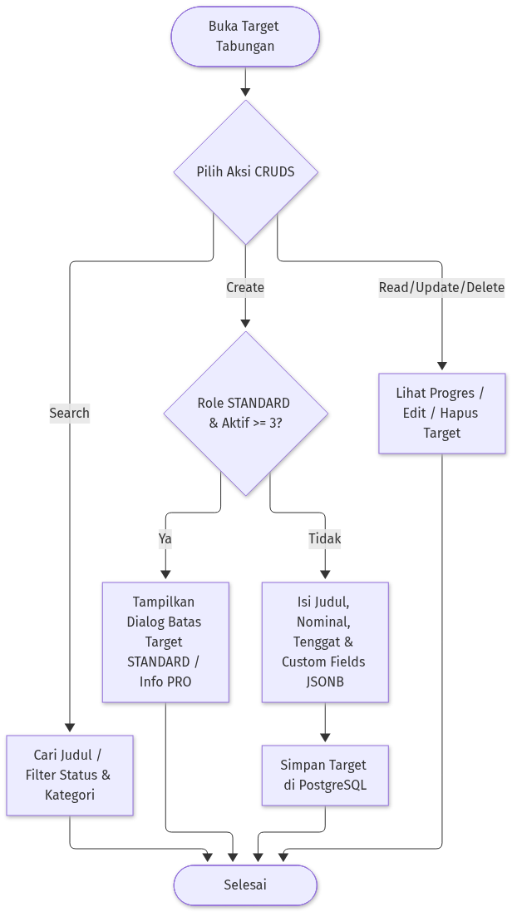

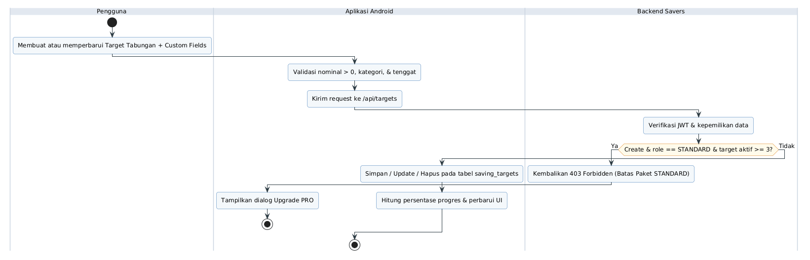

---

### 3.5 Manajemen Transaksi & Setoran (CRUDS)
#### 3.5.1 Description and Priority
Mencatat dan mengelola seluruh arus kas pengguna: Setoran ke Target Tabungan (`DEPOSIT`), Pemasukan Umum (`INCOME`), dan Pengeluaran Umum (`EXPENSE`), lengkap dengan operasi CRUDS dan field dinamis.  
**Prioritas:** Must (High — Benefit: 9, Penalty: 9, Cost: 6, Risk: 5).

#### 3.5.2 Stimulus/Response Sequences
1. Pengguna menambah transaksi baru (memilih tipe, kategori, nominal > 0, tanggal, catatan, target jika `DEPOSIT`, serta field dinamis `extra_attributes` seperti `metode_pembayaran` / `lokasi`) → Sistem menyimpan transaksi; jika bertipe `DEPOSIT`, saldo `current_amount` target bertambah secara atomik di database.
2. Pengguna mencari transaksi berdasarkan catatan, tipe, atau rentang tanggal → Sistem menampilkan daftar transaksi yang sesuai.
3. Pengguna mengubah nominal/kategori atau menghapus transaksi → Sistem memperbarui catatan dan menyesuaikan kembali `current_amount` target terkait secara atomik.

#### 3.5.3 Functional Requirements
* **FR-TRX-1 (Create):** Pengguna harus dapat mencatat transaksi (`DEPOSIT`, `INCOME`, `EXPENSE`) dengan nominal > 0, tanggal, kategori, relasi ke `saving_targets` (wajib jika `DEPOSIT`), dan field dinamis `extra_attributes`.
* **FR-TRX-2 (Read):** Sistem harus menampilkan riwayat dan detail transaksi milik pengguna terurut dari yang terbaru.
* **FR-TRX-3 (Update):** Pengguna harus dapat mengubah detail transaksi miliknya; perubahan nominal atau target pada transaksi `DEPOSIT` harus otomatis merekonsiliasi `current_amount` pada target terkait.
* **FR-TRX-4 (Delete):** Pengguna harus dapat menghapus transaksi miliknya dan saldo target terkait otomatis dikurangi/direkonsiliasi.
* **FR-TRX-5 (Search):** Pengguna harus dapat mencari transaksi berdasarkan kata kunci catatan serta memfilter berdasarkan tipe transaksi, kategori, atau rentang tanggal.

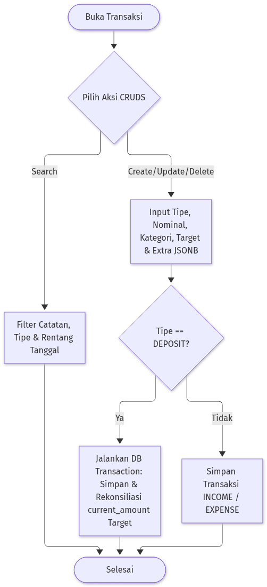

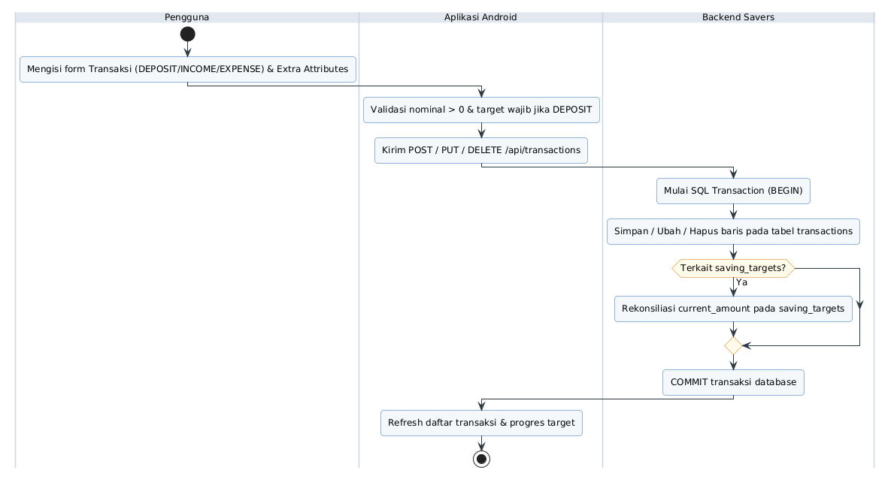

---

### 3.6 Manajemen Rencana Setoran Berkala (CRUDS — Fitur `PRO`)
#### 3.6.1 Description and Priority
Membantu pengguna `PRO` membuat jadwal rencana setoran rutin (harian/mingguan/bulanan) ke suatu target tabungan beserta pengingat lokal dan field dinamis konfigurasi jadwal.  
**Prioritas:** Must (High — Benefit: 8, Penalty: 8, Cost: 5, Risk: 4).

#### 3.6.2 Stimulus/Response Sequences
1. Pengguna `PRO` membuat rencana berkala (pilih target, judul, nominal rutin, frekuensi `DAILY`/`WEEKLY`/`MONTHLY`, tanggal eksekusi berikutnya, dan field dinamis `schedule_config`) → Sistem menyimpan rencana dan menjadwalkan pengingat lokal.
2. Pengguna `STANDARD` mengakses fitur ini → UI menampilkan status terkunci (`PRO`) dan backend menolak akses langsung (`403 Forbidden`).
3. Pengguna `PRO` dapat mencari, mengubah nominal/frekuensi/status aktif, mengonfirmasi setoran dari jadwal, atau menghapus rencana.

#### 3.6.3 Functional Requirements
* **FR-REC-1 (Create):** Pengguna `PRO` harus dapat membuat rencana setoran berkala yang terhubung ke `saving_targets` miliknya dengan field dinamis `schedule_config`.
* **FR-REC-2 (Read):** Pengguna `PRO` harus dapat melihat daftar dan detail rencana setoran berkala miliknya.
* **FR-REC-3 (Update):** Pengguna `PRO` harus dapat mengubah nominal, frekuensi, tanggal berikutnya, status aktif (`is_active`), dan `schedule_config`.
* **FR-REC-4 (Delete):** Pengguna `PRO` harus dapat menghapus rencana setoran berkala miliknya.
* **FR-REC-5 (Search):** Pengguna `PRO` harus dapat mencari rencana berdasarkan judul dan memfilter berdasarkan frekuensi atau status aktif.

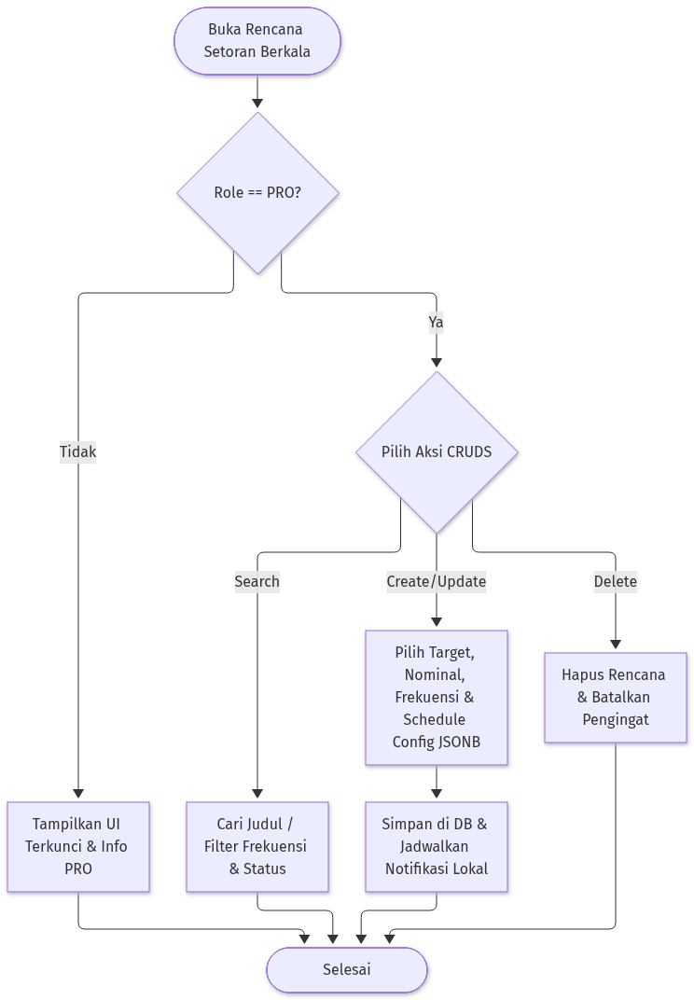

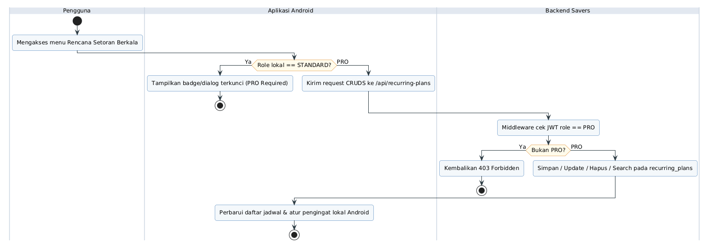

---

### 3.7 Manajemen Anggaran Bulanan / Monthly Budgets (CRUDS — Fitur `PRO`)
#### 3.7.1 Description and Priority
Memungkinkan pengguna `PRO` menetapkan batas anggaran pengeluaran bulanan per kategori, memantau realisasi pengeluaran terhadap anggaran, serta mencari dan mengelola anggaran dengan field dinamis aturan peringatan.  
**Prioritas:** Should/Must (High — Benefit: 8, Penalty: 7, Cost: 5, Risk: 4).

#### 3.7.2 Stimulus/Response Sequences
1. Pengguna `PRO` membuat anggaran bulanan (pilih kategori pengeluaran, bulan/tahun, batas nominal > 0, dan field dinamis `alert_rules` misal ambang peringatan 80%) → Sistem menyimpan anggaran dan menghitung progres pemakaian dari transaksi `EXPENSE` bulan terkait.
2. Pengguna `PRO` mencari anggaran berdasarkan bulan/kategori, mengedit batas nominal, atau menghapus anggaran.

#### 3.7.3 Functional Requirements
* **FR-BGT-1 (Create):** Pengguna `PRO` harus dapat membuat anggaran bulanan per kategori dan periode (bulan/tahun) beserta field dinamis `alert_rules`.
* **FR-BGT-2 (Read):** Sistem harus menampilkan daftar anggaran bulanan lengkap dengan nominal terpakai, sisa anggaran, dan indikator peringatan jika melewati ambang batas.
* **FR-BGT-3 (Update):** Pengguna `PRO` harus dapat memperbarui batas nominal dan `alert_rules` anggaran miliknya.
* **FR-BGT-4 (Delete):** Pengguna `PRO` harus dapat menghapus anggaran bulanan miliknya.
* **FR-BGT-5 (Search):** Pengguna `PRO` harus dapat mencari/memfilter anggaran berdasarkan nama kategori atau periode bulan/tahun.

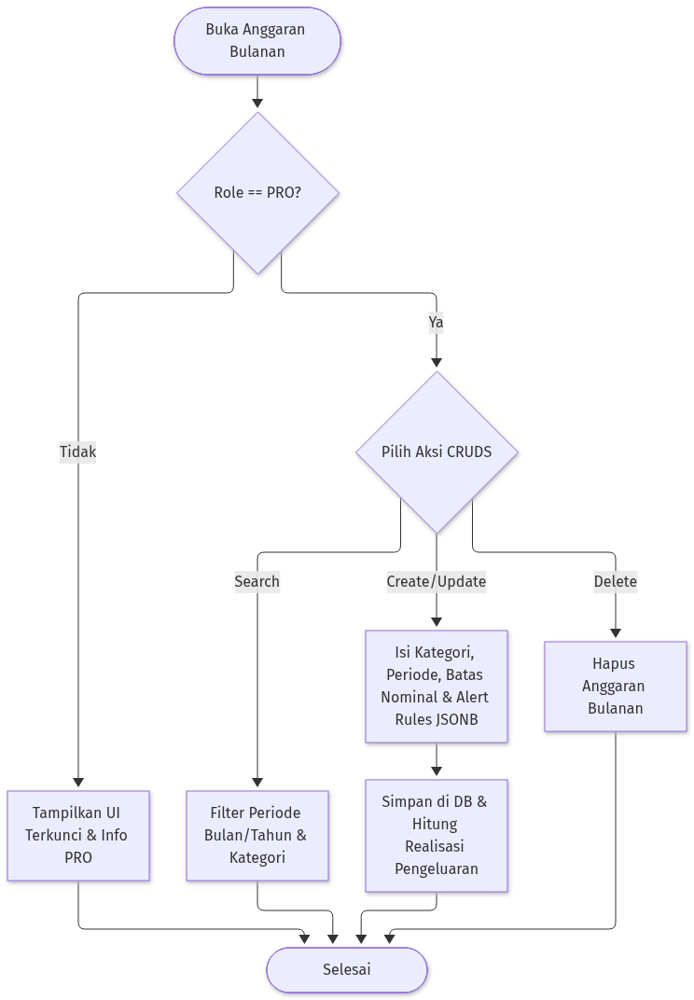

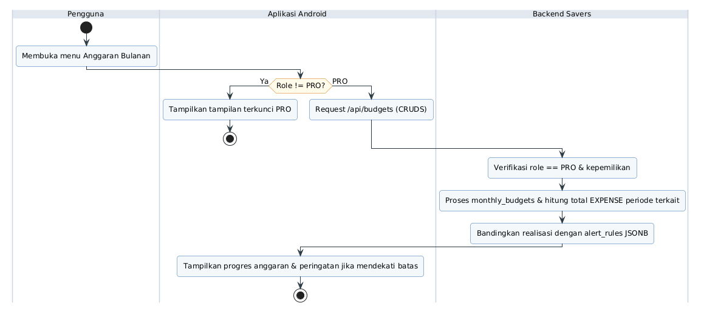

---

### 3.8 Ekspor, Simpan & Baca File Laporan Lokal (PDF/CSV) + Cache Offline
#### 3.8.1 Description and Priority
Mengambil ringkasan data finansial dari backend, menyimpannya sebagai berkas **CSV** (semua role) atau **PDF** (khusus `PRO`) di penyimpanan lokal Android, serta membaca dan menampilkan daftar/isi berkas laporan lokal langsung di aplikasi.  
**Prioritas:** Must (High — Benefit: 8, Penalty: 9, Cost: 5, Risk: 4).

#### 3.8.2 Stimulus/Response Sequences
1. Pengguna memilih rentang tanggal laporan dan menekan tombol Ekspor CSV atau Ekspor PDF (`PRO`) → Sistem menyusun file dan menyimpannya ke direktori lokal aplikasi (`filesDir/reports/`).
2. Pengguna membuka tab/bagian **Arsip Laporan Lokal** → Sistem membaca direktori lokal, menampilkan daftar file PDF/CSV beserta ukuran dan waktu dibuat; pengguna dapat membuka/membaca isi laporan (preview tabel CSV / viewer PDF) atau menghapus file lokal.

#### 3.8.3 Functional Requirements
* **FR-FILE-1 (Simpan):** Aplikasi harus dapat menghasilkan dan menyimpan file laporan ke penyimpanan lokal Android dalam format **CSV** (role `STANDARD` & `PRO`) dan **PDF** (role `PRO`).
* **FR-FILE-2 (Baca):** Aplikasi harus dapat memindai, membaca metadata (nama, ukuran, tanggal), dan menampilkan isi/preview file laporan lokal yang tersimpan di perangkat.
* **FR-FILE-3 (Cache Offline):** Aplikasi harus menyimpan cache JSON ringkasan dashboard terakhir secara lokal (bukan Room/SQLite) untuk ditampilkan dalam mode baca-saja saat perangkat offline.

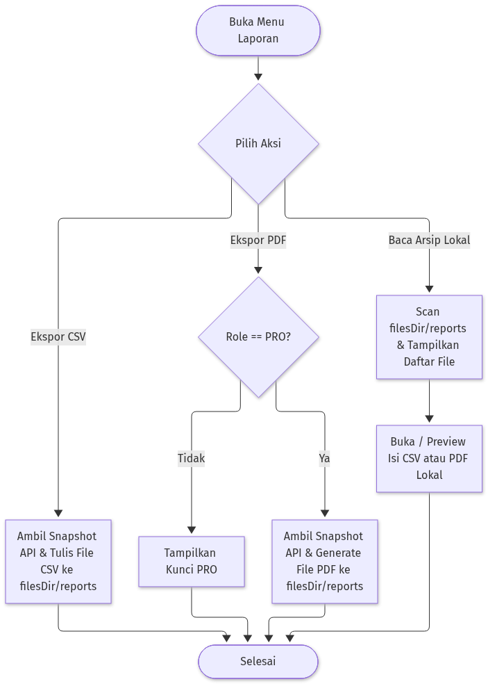

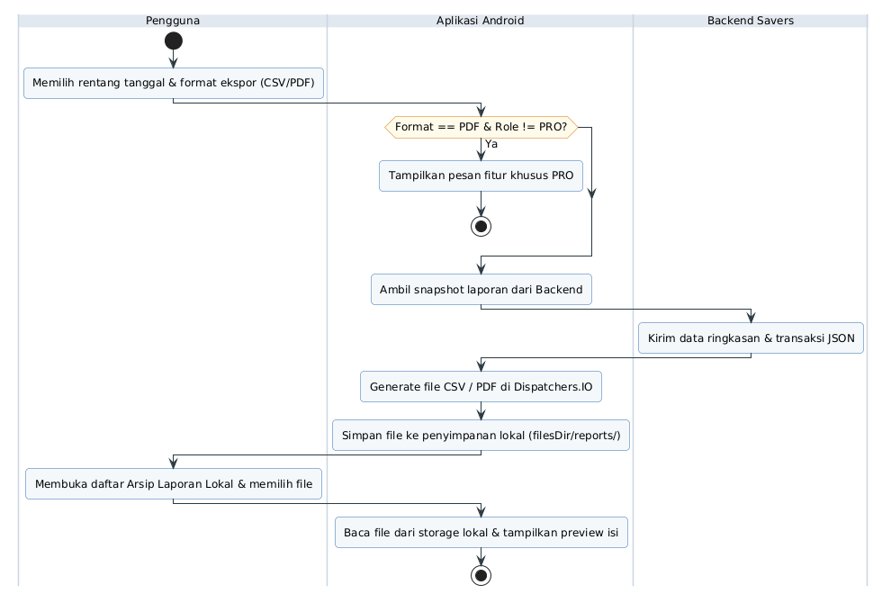

---

## 4 External Interface Requirements

### 4.1 User Interfaces
* **IR-UI-1:** Seluruh antarmuka dibangun menggunakan **Jetpack Compose + Material 3** (tanpa XML/View tradisional).
* **IR-UI-2:** Navigasi multi-halaman sepenuhnya menggunakan **Jetpack Navigation Compose** (`NavHost`) dengan pemisahan `AuthGraph` dan `MainGraph`.
* **IR-UI-3:** Form input harus menampilkan pesan validasi yang jelas secara *inline* sebelum/saat dikirim ke server.
* **IR-UI-4:** Fitur khusus `PRO` harus menampilkan indikator visual (badge/ikon gembok) bagi pengguna `STANDARD` (*Role-based UI*).

### 4.2 Hardware Interfaces
* **IR-HW-1:** Berjalan pada perangkat smartphone Android dengan akses penyimpanan internal untuk menyimpan dan membaca file laporan PDF/CSV.
* **IR-HW-2:** Menggunakan layanan notifikasi perangkat Android untuk pengingat jadwal rencana setoran berkala (dengan izin pengguna).

### 4.3 Software Interfaces
* **IR-SW-1:** Klien Android menggunakan Kotlin, Jetpack Compose, Navigation Compose, ViewModel (`StateFlow`), Retrofit + OkHttp + Kotlinx Serialization/Gson, dan Jetpack DataStore. **Room dan SQLite tidak digunakan.**
* **IR-SW-2:** Backend menggunakan Node.js + Express REST API dan terhubung ke database **PostgreSQL Cloud** menggunakan driver/ORM (misal `pg` atau Prisma).

### 4.4 Communications Interfaces
* **IR-COM-1:** Komunikasi klien-server menggunakan protokol **HTTPS/TLS** dengan format pertukaran data **JSON**.
* **IR-COM-2:** Autentikasi menggunakan header `Authorization: Bearer <access_token>`.

---

## 5 Other Nonfunctional Requirements

### 5.1 Performance Requirements
* **NFR-PERF-1:** Waktu muat daftar data dari REST API pada kondisi jaringan normal maksimal 2 detik dengan indikator *loading state* di UI.
* **NFR-PERF-2:** Proses generate dan simpan file laporan CSV/PDF lokal untuk hingga 1.000 baris transaksi selesai dalam waktu kurang dari 3 detik tanpa memblokir *main UI thread* (menggunakan Kotlin Coroutines `Dispatchers.IO`).

### 5.2 Safety Requirements
* **NFR-SAFE-1:** Setiap aksi destruktif (hapus target, transaksi, rencana berkala, anggaran, kategori, atau file lokal) wajib didahului dialog konfirmasi di UI.
* **NFR-SAFE-2:** Operasi transaksi `DEPOSIT` yang mengubah saldo target harus menggunakan transaksi database (`BEGIN ... COMMIT / ROLLBACK`) di PostgreSQL agar saldo tidak korup saat terjadi kegagalan.

### 5.3 Security Requirements
* **NFR-SEC-1:** Kata sandi pengguna wajib di-hash (bcrypt/argon2) sebelum disimpan di PostgreSQL; tidak boleh disimpan dalam bentuk *plaintext*.
* **NFR-SEC-2:** *Refresh token* disimpan dalam bentuk hash di database dan dapat dicabut (*revoked*) saat logout.
* **NFR-SEC-3:** Setiap endpoint resource wajib memverifikasi JWT, kepemilikan `user_id`, dan role (`STANDARD`/`PRO`) di sisi server.

### 5.4 Software Quality Attributes
* **NFR-QUAL-1 (Maintainability):** Struktur kode Android menerapkan pola **MVVM** secara konsisten dengan pemisahan layer `ui`, `viewmodel`, `data/repository`, dan `network`.
* **NFR-QUAL-2 (Usability):** Pesan error jaringan, validasi form, dan status offline ditampilkan dalam Bahasa Indonesia yang mudah dipahami pengguna.
* **NFR-QUAL-3 (Testability):** `ViewModel` dan endpoint backend dapat diuji secara terpisah (*unit/integration test*).

---

## 6 Other Requirements

### 6.1 Kebutuhan Basis Data & Field Dinamis (`DBR`)
Database menggunakan **PostgreSQL Cloud** dengan **6 Entitas Utama** berelasi (melebihi syarat minimal 4 entitas) + 1 tabel pendukung autentikasi. Setiap entitas utama memiliki kolom bertipe `JSONB` untuk **field dinamis**:

1. **`users`**: `id` (PK, UUID), `name`, `email` (UNIQUE), `password_hash`, `role` (`STANDARD` | `PRO`), `is_active`, **`preferences` (`JSONB` - field dinamis)**, `created_at`.
2. **`categories`**: `id` (PK, UUID), `user_id` (FK -> `users.id`, NULL untuk kategori bawaan), `name`, `type` (`INCOME` | `EXPENSE` | `SAVING`), `icon`, `color_hex`, **`metadata` (`JSONB` - field dinamis)**, `created_at`.
3. **`saving_targets`**: `id` (PK, UUID), `user_id` (FK -> `users.id`), `category_id` (FK -> `categories.id`), `title`, `target_amount`, `current_amount`, `deadline`, `status` (`ACTIVE` | `COMPLETED` | `PAUSED`), **`custom_fields` (`JSONB` - field dinamis)**, `created_at`.
4. **`transactions`**: `id` (PK, UUID), `user_id` (FK -> `users.id`), `target_id` (nullable FK -> `saving_targets.id`), `category_id` (FK -> `categories.id`), `type` (`DEPOSIT` | `INCOME` | `EXPENSE`), `amount`, `note`, `transaction_date`, **`extra_attributes` (`JSONB` - field dinamis)**, `created_at`.
5. **`recurring_plans`**: `id` (PK, UUID), `user_id` (FK -> `users.id`), `target_id` (FK -> `saving_targets.id`), `title`, `amount`, `frequency` (`DAILY` | `WEEKLY` | `MONTHLY`), `next_run_date`, `is_active`, **`schedule_config` (`JSONB` - field dinamis)**, `created_at`.
6. **`monthly_budgets`**: `id` (PK, UUID), `user_id` (FK -> `users.id`), `category_id` (FK -> `categories.id`), `period_month` (1–12), `period_year`, `limit_amount`, **`alert_rules` (`JSONB` - field dinamis)**, `created_at`.
7. **`refresh_tokens`** *(Pendukung Auth)*: `id` (PK, UUID), `user_id` (FK -> `users.id`), `token_hash`, `expires_at`, `revoked_at`, `created_at`.

### 6.2 Relasi Antar Tabel (RAT) & ERD
Ringkasan relasi antar entitas utama:
* `users` (1) ──< (N) `categories` *(nullable untuk kategori bawaan sistem)*
* `users` (1) ──< (N) `saving_targets`
* `users` (1) ──< (N) `transactions`
* `users` (1) ──< (N) `recurring_plans`
* `users` (1) ──< (N) `monthly_budgets`
* `users` (1) ──< (N) `refresh_tokens`
* `categories` (1) ──< (N) `saving_targets`
* `categories` (1) ──< (N) `transactions`
* `categories` (1) ──< (N) `monthly_budgets`
* `saving_targets` (1) ──< (N) `transactions` *(opsional untuk transaksi `DEPOSIT`)*
* `saving_targets` (1) ──< (N) `recurring_plans`

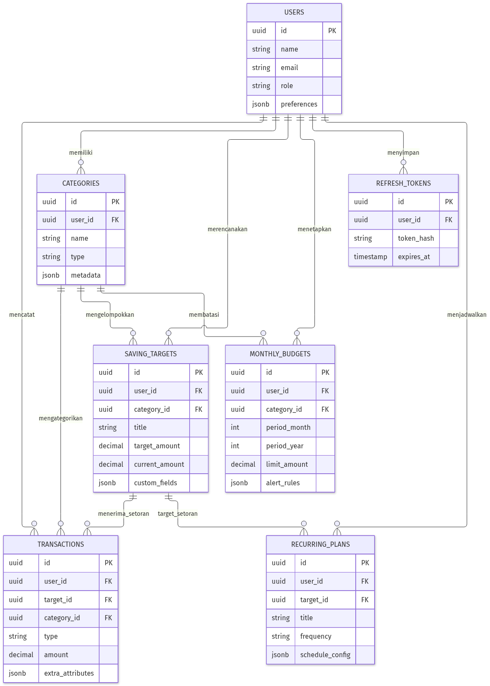

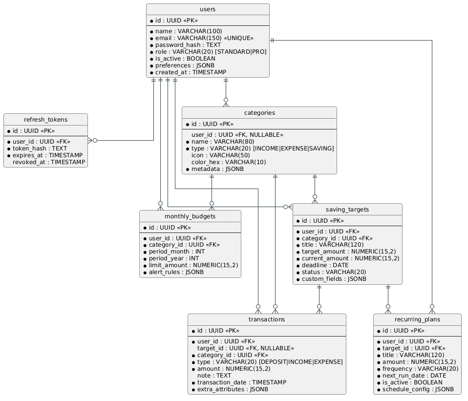

### 6.3 Matriks Keterlacakan (Pedoman ↔ SRS)
| Syarat Pedoman | Implementasi di Savers | ID Kebutuhan SRS |
| --- | --- | --- |
| Authentication (Login, Register, JWT + Refresh) | Auth + DataStore + OkHttp Authenticator | `FR-AUTH-1` s.d. `FR-AUTH-4` |
| Authorization (Role-based UI) | Role `STANDARD` & `PRO` di UI & Backend | `FR-AUTH-5`, `FR-DASH-2`, `IR-UI-4` |
| Navigasi & Routing | 100% Jetpack Navigation Compose (`NavHost`) | `IR-UI-2` |
| State Management | 100% MVVM + `StateFlow` | `NFR-QUAL-1` |
| ≥ 4 Entitas Utama + Field Dinamis | 6 Entitas Utama PostgreSQL + `JSONB` | Bab 6.1 (`DBR`) |
| ≥ 5 Fitur CRUDS Penuh | Kategori, Target, Transaksi, Rencana Berkala, Anggaran Bulanan | `FR-CAT-*`, `FR-TGT-*`, `FR-TRX-*`, `FR-REC-*`, `FR-BGT-*` |
| REST API Integration | Node.js/Express JSON + Retrofit/OkHttp | `IR-SW-2`, `IR-COM-1` |
| Database (Min MySQL, Dilarang Room) | PostgreSQL Cloud (tanpa Room/SQLite) | Bab 2.5, `IR-SW-1`, Bab 6.1 |
| File Storage (Simpan & Baca Lokal) | Ekspor PDF/CSV & Baca Arsip Laporan Lokal | `FR-FILE-1` s.d. `FR-FILE-3` |
| UI/UX Jetpack Compose | 100% Jetpack Compose Material 3 | `IR-UI-1` |

---

## Appendix A: Glossary
* **Access Token:** Token JWT berumur pendek yang dikirim di setiap header request untuk mengakses resource API yang dilindungi.
* **Field Dinamis (`JSONB`):** Kolom terstruktur fleksibel pada PostgreSQL yang memungkinkan pengguna menyimpan atribut tambahan kustom tanpa mengubah skema tabel.
* **Refresh Token:** Token berumur lebih panjang yang digunakan untuk mendapatkan *access token* baru tanpa meminta pengguna login ulang.
* **Role-Based UI:** Mekanisme antarmuka yang menyesuaikan tampilan, menu, atau status terkunci berdasarkan peran (`STANDARD` atau `PRO`) pengguna yang sedang login.
* **Snapshot Laporan:** Hasil rekapitulasi finansial pada rentang tanggal tertentu yang diekspor dan disimpan sebagai file lokal (PDF/CSV).
